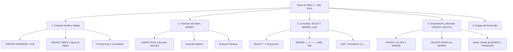

# Plan de Implementación: Documentación Web Interactiva de Base de Datos 1 (SQL)


con los dedos de las manos y los dedos de los pies

bernabe es un poco gay


Sitio web educativo con estética de documentación técnica oficial moderna (inspirado en Stripe Docs / VitePress / Tailwind Docs), diseñado de forma minimalista con detalles en colores pasteles (azul, amarillo, rojo), navegación intuitiva y un simulador SQL interactivo integrado.

---

## 1. Objetivos del Proyecto

- **Propósito**: Crear una guía de documentación interactiva y de referencia rápida sobre conceptos fundamentales de SQL para la materia de Base de Datos 1.
- **Asignación Explícita de Módulos por Desarrollador**:
  - **Módulo 1 (Creación de Base de Datos y Tablas)**: 👤 **David Párraga** (Responsable Técnico)
    * `CREATE DATABASE`, `USE`, `CREATE TABLE`, tipos de datos primitivos, restricciones (`PRIMARY KEY`, `NOT NULL`, `AUTO_INCREMENT`).
  - **Módulo 2 (Inserción de Datos con SQL)**: 👤 **Javier Infante** (Responsable Técnico)
    * `INSERT INTO` (fila simple, inserción masiva, selección de columnas y buenas prácticas).
  - **Módulo 3 (Consultas de Selección: SELECT, WHERE, LIKE)**: 👤 **Carlos Bernabe** (Responsable Técnico)
    * `SELECT` simple, proyecciones, alias, filtrado con `WHERE` y coincidencia de patrones con `LIKE` (`%`, `_`).
  - **Módulo 4 (Modificación y Eliminación: UPDATE y DELETE)**: 👤 **Deivy Prudente** (Responsable Técnico)
    * `UPDATE` y `DELETE` con `WHERE`, diferencias con `TRUNCATE` y alertas de seguridad críticas.

---

## 2. Decisiones de Diseño y Estética

> [!NOTE]
> Se adoptará un enfoque **Documentación Oficial Minimalista**:
> - **Tipografía**: Fuentes legibles y profesionales (`Inter` / `Plus Jakarta Sans` para lectura y `JetBrains Mono` / `Fira Code` para bloques de código).
> - **Paleta Pastel Funcional**:
>   - **Azul Pastel** (`#E0EDFF` / bordes `#93C5FD` / acento `#2563EB`): Para navegación, bloques de consulta `SELECT`, conceptos estructurales y notas informativas.
>   - **Amarillo Pastel** (`#FEF9C3` / bordes `#FDE047` / acento `#CA8A04`): Para inserciones `INSERT`, advertencias preventivas, tips de rendimiento y buenas prácticas.
>   - **Rojo/Coral Pastel** (`#FEE2E2` / bordes `#FCA5A5` / acento `#DC2626`): Para operaciones destructivas `DELETE`/`DROP`, errores comunes y alertas críticas ("¡Cuidado con UPDATE sin WHERE!").
>   - **Neutros Limpios**: Blanco puro (`#FFFFFF`) y gris perla (`#F8FAFC`, `#F1F5F9`) para fondos, con texto en gris carbón de alto contraste (`#0F172A`).
> - **Componentes UI Clave**:
>   - Barra lateral izquierda colapsable con árbol de navegación categorizado.
>   - Barra de búsqueda instantánea para filtrar lecciones, comandos y sintaxis en tiempo real.
>   - Tabla de contenidos a la derecha ("En esta página") con scroll spy activo.
>   - Bloques de código con botón interactivo de "Copiar al portapapeles", números de línea y resaltado de sintaxis SQL.
>   - **Simulador SQL en Vivo (Playground)**: Motor simulado en JavaScript que permite ejecutar `SELECT`, `INSERT`, `UPDATE`, `DELETE` sobre una base de datos en memoria y ver la tabla HTML resultante en tiempo real.
>   - **Sección de Créditos del Equipo**: Panel elegante y minimalista con tarjetas para los 4 desarrolladores.

---

## 3. Arquitectura de Archivos Propuesta

El proyecto se estructurará de forma limpia, modular y sin dependencias pesadas innecesarias (Vanilla HTML5, CSS3 moderno con variables custom properties y JavaScript ES6+):

```
c:/Users/ASUS/Desktop/ClasesDeBD/
├── index.html               # Página principal con layout de documentación completa
├── css/
│   ├── variables.css        # Sistema de diseño: colores pasteles, tipografías, espaciados
│   ├── base.css             # Resets, tipografía base y scrollbar minimalista
│   ├── layout.css           # Grid del layout: Sidebar, Main Content, TOC, Footer
│   ├── components.css       # Callouts pasteles, bloques de código, botones, buscador
│   └── playground.css       # Estilos del simulador SQL interactivo y visor de tablas
├── js/
│   ├── data.js              # Datos de la documentación y dataset inicial de prueba (SQLite/in-memory)
│   ├── app.js               # Lógica de navegación, scroll spy, buscador en vivo y tabs
│   ├── code-copy.js         # Utilidad para copiar fragmentos de código con toast feedback
│   └── sql-playground.js    # Motor de ejecución SQL interactivo simulado
└── assets/
    └── icons/               # Iconos SVG vectoriales limpios
```

---

## 4. Contenido Detallado de los 4 Módulos



### Módulo 1: Creación de Bases de Datos y Tablas — *Responsable: David Párraga*
- Explicación conceptual: ¿Qué es un esquema y qué es una tabla?
- `CREATE DATABASE universidad_db;` y `USE universidad_db;`
- Tipos de datos esenciales (`INT`, `VARCHAR(n)`, `DECIMAL(p,s)`, `DATE`, `BOOLEAN`).
- Creación de tabla con `PRIMARY KEY`, `NOT NULL` y `AUTO_INCREMENT`.
- Diagrama interactivo de estructura de columnas.

### Módulo 2: Inserción de Datos (`INSERT`) — *Responsable: Javier Infante*
- Sintaxis estándar `INSERT INTO tabla (col1, col2) VALUES (val1, val2);`
- Inserción sin especificar columnas vs especificándolas (buenas prácticas de mantenimiento).
- Inserción de múltiples registros en un solo comando.
- Ejemplos prácticos sobre una tabla `estudiantes`.

### Módulo 3: Consultas (`SELECT`, `WHERE`, `LIKE`) — *Responsable: Carlos Bernabe*
- `SELECT` simple: consulta total (`*`) vs proyección de campos específicos con alias (`AS`).
- Filtrado con `WHERE`:
  - Operadores de comparación (`=`, `!=` o `<>`, `<`, `>`, `<=`, `>=`).
  - Operadores lógicos (`AND`, `OR`, `NOT`).
  - Rango y listas (`BETWEEN`, `IN`).
- Búsqueda de patrones con `LIKE`:
  - Comodín `%` (cero o más caracteres).
  - Comodín `_` (un único carácter).
  - Búsqueda por inicial, terminación, contenido intermedio o dominios de email.

### Módulo 4: Actualización y Borrado (`UPDATE` y `DELETE`) — *Responsable: Deivy Prudente*
- `UPDATE`: sintaxis `UPDATE tabla SET columna = nuevo_valor WHERE condicion;`
- `DELETE`: sintaxis `DELETE FROM tabla WHERE condicion;`
- **Callout Rojo Pastel de Seguridad**:
  - Demostración visual de la catástrofe de olvidar la cláusula `WHERE`.
  - Comparativa entre `DELETE`, `TRUNCATE TABLE` y `DROP TABLE`.
  - Transacciones seguras (`BEGIN TRANSACTION`, `ROLLBACK`, `COMMIT`).

### Módulo 5: Créditos y Roles del Equipo
- Tarjetas minimalistas con badges y estilo de equipo de ingeniería de software:
  - **David Párraga**: Módulo 1 (Creación de BD y Tablas)
  - **Javier Infante**: Módulo 2 (Inserción de Datos con INSERT)
  - **Carlos Bernabe**: Módulo 3 (Consultas SELECT, WHERE, LIKE)
  - **Deivy Prudente**: Módulo 4 (Actualización y Borrado UPDATE / DELETE)

---

## 5. Simulador SQL Interactivo (Playground)

Incluiremos una consola en vivo que simula una base de datos de ejemplo (`estudiantes` y `cursos`):
- Los estudiantes pueden escribir o hacer clic en consultas precargadas:
  - `SELECT nombre, carrera FROM estudiantes WHERE edad >= 20;`
  - `SELECT * FROM estudiantes WHERE email LIKE '%@gmail.com';`
  - `UPDATE estudiantes SET promedio = 9.5 WHERE id = 1;`
  - `INSERT INTO estudiantes (nombre, edad, carrera) VALUES ('Ana Torres', 21, 'Sistemas');`
- Al pulsar **"Ejecutar Consulta"**, se actualiza visualmente la tabla de resultados en pantalla o se muestra un mensaje de filas afectadas / error explicativo amigable.

---

## 6. Plan de Verificación

### Pruebas Funcionales:
1. **Navegación**: Verificar que el sidebar, los enlaces de la tabla de contenidos y el buscador filtren y dirijan a la sección exacta sin saltos bruscos (smooth scrolling).
2. **Interactividad**:
   - Probar el botón de copiar en cada bloque de código y validar que cambie a "¡Copiado!".
   - Probar el simulador SQL con consultas `SELECT`, `INSERT`, `UPDATE` y `DELETE`, comprobando la persistencia temporal en memoria durante la sesión.
3. **Responsividad**:
   - Verificar la vista en pantallas de escritorio, tablets y móviles (el sidebar se convierte en menú drawer colapsable).
4. **Validación de Código y Estética**:
   - Asegurar que la paleta cumpla con el requerimiento exacto: minimalista, pasteles (azul, amarillo, rojo), sin recargar la interfaz.
